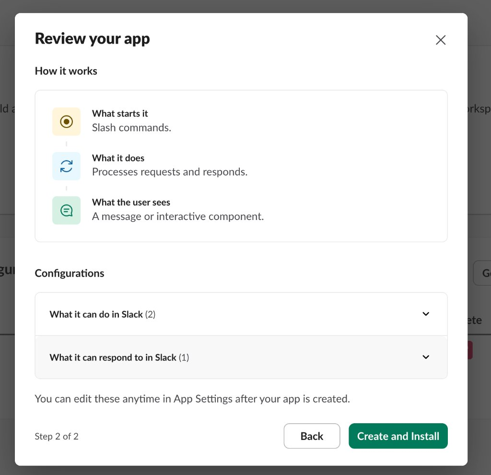
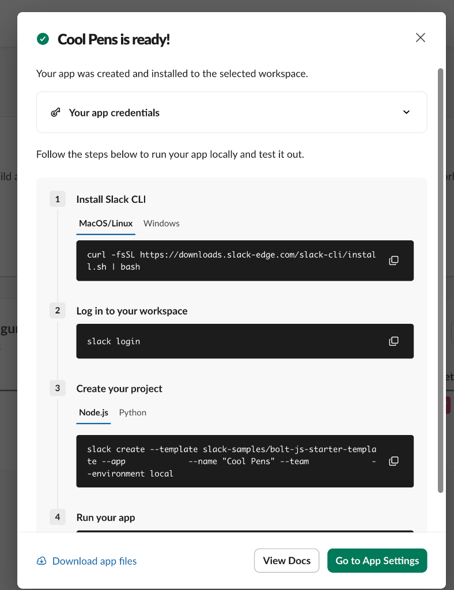

# Cool Pens

A shared office stationery cupboard in Slack, built on [Remack](https://github.com/robjshaw/remack), with **direct conversations with Officeworks’ Ollie**.

Ask for great pens, request the products Ollie finds, and let a cupboard owner review a restock. Track what is on the shelf and record deliveries. The MVP supports one Slack workspace, one cupboard, and one active restock batch.

## Demo

[Watch the studio demo video (MOV, 9.2 MB)](docs/cool-pens-studio-demo.mov)

## Get started in 2 minutes

Requires Node 22 or newer.

1. **Install dependencies:**
   ```sh
   npm ci --ignore-scripts
   ```
2. **Start a public HTTPS tunnel** to your local port (Slack sends requests to `/events` over HTTPS):
   ```sh
   cloudflared tunnel --url http://localhost:3000
   ```
   Copy the printed `https://<random>.trycloudflare.com` URL (or use your hosted HTTPS origin). See [Local development tunnel](#local-development-tunnel) for details.
3. **Generate the Slack app manifest** and copy the JSON output:
   ```sh
   npm run manifest -- https://YOUR-PUBLIC-HOST
   ```
4. **Create and install the app in Slack:**
   - Go to [api.slack.com/apps](https://api.slack.com/apps) and click **Create an App** → **From a manifest**.
   - Pick your workspace, switch to the **JSON** tab, and paste the manifest.
   - Review the app summary and click **Create and Install** (the manifest requests `commands` and `chat:write`, enables App Home, and routes commands, interactions, and events to `/events`).

   

5. **Configure `.env`:**
   On the **Cool Pens is ready!** screen, expand **Your app credentials** (or click **Go to App Settings**) — you can skip the Slack CLI steps shown below it.

   

   Copy `.env.example` to `.env` and fill in the four required Slack values (no Gemini or Officeworks API key is required):
   - `SLACK_SIGNING_SECRET` — from **Your app credentials** (or **Basic Information → App Credentials → Signing Secret**)
   - `SLACK_BOT_TOKEN` — `xoxb-...` from **Your app credentials** (or **OAuth & Permissions → Bot User OAuth Token**)
   - `SLACK_TEAM_ID` — workspace ID (`T...`) from your Slack URL (`https://app.slack.com/client/T.../`)
   - `CUPBOARD_OWNER_IDS` — comma-separated member IDs (`U...`) allowed to count stock, approve restocks, and record deliveries (Slack profile → **⋮ → Copy member ID**)
   - Optional: `PUBLIC_BASE_URL` (set to your `https://...` tunnel or hosted origin so **Open Officeworks cart** links work from any machine), `OFFICEWORKS_STATE` (defaults to `NSW`), `OFFICEWORKS_POSTCODE`, `PORT` (defaults to `3000`).
6. **Start the app** in a second terminal:
   ```sh
   npm run dev
   ```
   `/healthz` returns `ok`. Open the app’s **Home** tab or run `/cupboard` in Slack.

Credentials are only read at runtime. Never commit `.env`.

## Try it without Slack

```sh
npm test
npm run demo
```

Talk to the real Ollie without Slack credentials:

```sh
npm run ollie -- "Find good gel pen multipacks for a team of 10 under $30"
```

This sends the question to Officeworks and Google in a fresh anonymous shopping session. It returns Ollie’s text and product URLs. It does not use your Officeworks account or browser cookies. Network access is required; the automated tests run entirely offline.

## Slack configuration

### Local development tunnel

The app receives Slack requests over HTTP (Socket Mode is not used), so Slack needs a public HTTPS URL that forwards to your local port. `npm test`, `npm run demo`, and `npm run ollie` work without one.

With [cloudflared](https://developers.cloudflare.com/cloudflare-one/connections/connect-networks/downloads/) (no Cloudflare account needed for a quick tunnel):

```sh
brew install cloudflared
cloudflared tunnel --url http://localhost:3000
```

Use the printed `https://<random>.trycloudflare.com` URL as the public host in step 3 above, then run `npm run dev` in a second terminal. Match the port to `PORT` in `.env` if you change it.

A quick tunnel gets a new URL every time `cloudflared` restarts. When it changes, run `npm run manifest` again with the new URL and apply the updated manifest to your Slack app; the URL is used for events, interactivity, and the slash command. For a stable hostname, use a named tunnel on a domain you manage in Cloudflare.

### Office postcode

Optionally set `OFFICEWORKS_POSTCODE` in `.env` alongside `OFFICEWORKS_STATE`:

```dotenv
OFFICEWORKS_STATE=NSW
OFFICEWORKS_POSTCODE=2000
```

Use the office's postcode for the shared cupboard. This example is not a configured delivery address. Blank keeps the existing state-only behaviour. A supplied postcode must be four digits; leading zeros are preserved (for example, `0800`). This validates the format, not whether the postcode exists or matches the state. Restart the bot after changing `.env`.

Both Slack chat and the CLI include this postcode in each question sent to Ollie. The observed token API supports state; no structured postcode field has been verified. Postcode context does not set an Officeworks delivery address, select a pickup store, or guarantee local stock.

Slack has no standard postcode field in its [user object](https://docs.slack.dev/reference/objects/user-object/). If your workspace maintains an office profile field, the bot can read it through [users.profile.get](https://docs.slack.dev/reference/methods/users.profile.get/) and map the office name to a configured postcode. It never infers postcodes from timezones.

### Map Slack offices to postcodes

Set `OFFICE_LOCATIONS` in `.env` to a JSON object. These are example city-centre postcodes: replace them with the actual office postcodes and the office names used in Slack.

```dotenv
OFFICE_LOCATIONS='{"Sydney":{"state":"NSW","postcode":"2000"},"Melbourne":{"state":"VIC","postcode":"3000"}}'
SLACK_OFFICE_FIELD_ID=
```

With a nonempty mapping, the bot discovers a unique visible custom profile field labelled `Office`, `Location`, or `Office Location` using [team.profile.get](https://docs.slack.dev/reference/methods/team.profile.get/). If there are several candidates, a different label, or a hidden field, set `SLACK_OFFICE_FIELD_ID` to the exact field ID returned by that API. Office-name matching ignores case and extra whitespace; it does not fuzzy-match or guess.

Generate the updated manifest after setting the mapping:

```sh
npm run manifest -- https://YOUR-PUBLIC-HOST
```

The manifest adds `users.profile:read` only when the mapping is configured. Alternatively, append `--office-locations` to explicitly include the scope. Apply the manifest to your Slack app, reinstall it into the workspace to grant the added permission, and restart the bot. This changes local configuration only until you update the installed app.

Run `/cupboard location` to check your detected shopping location. Each Ollie answer also shows the location used. Lookups occur after Slack's acknowledgement and are cached for five minutes. Empty/unmapped fields, unavailable permissions, or a lookup taking more than five seconds use `OFFICEWORKS_STATE` / `OFFICEWORKS_POSTCODE`, with the fallback explained in the reply. Failed or unmatched lookups are retried after 30 seconds. Set `OFFICE_LOCATIONS={}` to disable profile lookups.

Only mapped state/postcode context is sent to Ollie; other Slack profile data is neither retained nor forwarded. Changing offices starts a fresh Ollie session after the cached profile refreshes. The CLI continues to use the default office configuration because it has no Slack user. The cupboard's inventory and restock list remain shared across the workspace; the mapping customises shopping recommendations, not inventory ownership or delivery destinations.

## Daily use

| Action | How |
| --- | --- |
| Open the cupboard | `/cupboard` or App Home |
| Talk to Ollie | `/cupboard ask Find some excellent black gel pens` |
| Ask a follow-up | Another `/cupboard ask …` from the same Slack user |
| Start a fresh conversation | `/cupboard new` |
| Check the shopping location | `/cupboard location` |
| Request a suggestion | “Request 1 pack / unit” on an Ollie product |
| Request supplies by name | “Request supplies” or `/cupboard request` |
| Record stock used | “Take from cupboard” or `/cupboard take` |
| Count stock and set targets | Owner: “Count stock” or `/cupboard count` |
| Review restocking | “Shopping list” or `/cupboard list` |
| Source the whole list | “Ask Ollie about this list”; review and send the prepared question |
| Approve a restock | Owner: review the list, then “Approve restock” |
| Record a delivery | Owner: shopping list → “Record full delivery” |

All quantities are **purchase units as sold**, such as a 10-pack of pens, a ream of paper, or a single notebook. “Take 1” for a pen 10-pack means taking one whole pack. Tracking individual pens inside packs is outside this MVP.

New items have unknown stock until an owner counts them. The restock quantity is the greater of open requested units and the shortfall to target. For example, two packs requested, one pack on hand, and a target of four produces a three-pack restock.

Approval snapshots the list and prevents another active batch. It does not buy anything. The owner gets **Open Officeworks cart** immediately after approval and in App Home. One click hands the approved quantities to Officeworks in the buyer’s browser for review and payment. Before recording a full delivery, count any unknown existing stock. A receipt increments stock once and closes only requests captured in that approved batch. Later requests remain open. Cancel a batch to revise it; cancellation does not cancel an Officeworks purchase.

## Approved list → Officeworks cart

The normal flow is **approve in Slack → Open Officeworks cart → review and pay**. No extension or separate account connection is required. The handoff opens Officeworks' native `OrderItemAdd` URL, which adds the approved SKUs and quantities using the browser's Officeworks session, then redirects to `/app/checkout`. Your usual Officeworks login and saved checkout details stay with Officeworks; Cool Pens never receives them.

Set `PUBLIC_BASE_URL` in `.env` to the running app's buyer-accessible HTTPS origin. For a demo on the same computer, leave it blank to use `http://localhost:3000` (or your configured `PORT`). Restart the app and refresh Slack App Home after changing the origin. The app must be running and reachable when the link is clicked.

Officeworks **adds** the approved quantities to the current cart. Existing products remain, and an existing quantity of the same SKU is increased. Review the full cart before payment. The integration cannot read the buyer's Officeworks cart from the app's separate website.

Cool Pens sets a first-party cookie recording the handoff attempt. Later clicks for that batch from the same browser open checkout without adding again. This is a convenience safeguard, not a transaction guarantee: cleared/blocked cookies, another browser/device, simultaneous first clicks, or manually reopening the Officeworks add URL can add the quantities again. The app does not claim that redirecting proves a successful import or purchase. Keep one responsible buyer for the batch.

Use **Cart help / retry** in the approved-order view if the first attempt fails or the list disappears after login. That page shows the approved quantities and an explicit retry action. Check the cart before retrying because a retry adds quantities again. Officeworks documents that logging in may restore the account's previously saved cart, so the guest-to-login transition still needs a real buyer-account check. The user confirmed the native link populated their browser cart with the extension disabled; whether that session was already authenticated was not established.

Every line needs an Officeworks SKU. Free-text requests retain search links and do not get a cart button; choose product suggestions before approving. Cancelling or receiving a batch invalidates its Cool Pens link. It does not undo cart changes already made or revoke a previously copied native Officeworks URL. Links expose only the approved item names, codes and quantities, not requester identities or Slack credentials. Keep them within the purchasing team and avoid logging the complete capability URLs at a production proxy.

Link previews, prefetches, and HEAD checks receive an informational page without a cart redirect. Normal top-level browser navigation triggers the handoff; browsers without Fetch Metadata headers get a button on the page. Retrying requires a same-origin form submission. Prices and availability remain Officeworks' responsibility, and final checkout/payment is manual.

**Verification:** on 25 November 2026, `OrderItemAdd` created a guest cart with `PM1956279 × 2` and `SM4518C24B × 1` and returned a checkout redirect. The integration probe follows the complete app → Officeworks → checkout HTTP chain, reads back the exact cart, and checks that a repeated app link does not duplicate items. Run `node scripts/probe-native-cart.mjs` explicitly to repeat it; it empties its disposable guest cart afterward and never places an order. The user also confirmed that the approved products appeared in their browser cart. The probe itself does not cover browser UI, and logging in after a guest import remains unverified. The optional `--edge-cases` probe verified that an invalid SKU returned HTTP 500 without partially adding the valid item or changing the existing cart.

## MVP boundaries

- **Direct Ollie integration is verified.** Anonymous token, authenticated configuration, and streamed chat returned HTTP 200 on 24 November 2026. Product records included IDs, names, AUD prices, and Officeworks URLs. See [the endpoint notes](docs/ollie-api.md).
- Ollie’s endpoints are undocumented website interfaces, not a supported public API or the standard A2A protocol. An upstream change can require an adapter update. Errors are surfaced without pretending the response is live.
- Approved-cart preparation uses Officeworks' native storefront URL and the buyer's browser session. Checkout/payment, budget enforcement, partial receipts, and purchase tracking remain manual. Ollie output cannot directly execute cart actions; the handoff uses only the owner-approved SKU/quantity snapshot.
- Prices come from Ollie and can change. Business pricing is not included. Product availability still needs confirmation for your delivery or pickup location.
- Cupboard data uses Remack’s atomic JSON file store. **Run one Node process on persistent storage.** The service serialises read/modify/write operations within that process. Do not run multiple replicas against the file. A replicated deployment needs transactional database updates, not just a KV adapter swap.
- `data/cupboard.json` survives restarts. Ollie sessions and product-button references are in memory and expire after an hour; restart starts fresh conversations. Tokens are never written to disk or logged.
- Limits: 80 tracked items, 200 open requests, one active batch, 20 completed batch records, and the last 1,000 mutation IDs for retry suppression. The home view shows a compact subset; forms and shopping lists include all current items.

## Project layout

- `lib/ollie.js`: anonymous session acquisition, streamed chat, product parsing, session isolation, bounded responses, and timeouts.
- `lib/locations.js`: optional Slack office field discovery, office-to-postcode mapping, caching, and explicit fallback.
- `lib/cupboard.js`: persisted requests, counts, restock approvals, receipts, owner permissions, and idempotency.
- `lib/cart-handoff.js`: revocable approved-order links, native cart redirects, repeat-click cookies, and retry help.
- `scripts/probe-native-cart.mjs`: live native handoff and repeat-click verification in an isolated guest session.
- `lib/views.js`, `lib/handlers.js`, `routes/`: Slack Block Kit UI and Remack handlers. Slow Ollie requests run after Slack’s acknowledgement.
- `scripts/probe-ollie.mjs`: reproducible endpoint probe; prints status and schema information, never tokens. Creates redacted, ignored research files.
- `test/`: domain, SSE/client, persistence, and signed Slack request tests using Node’s test runner.

Remack is pinned to commit `dedc063680e3fcbe52c6443753d7dccfda046292` (0.4.0). There are no other runtime dependencies.
